


[简体中文](./README.md) · **English**

 

I like turning everyday annoyances into small tools: plumbing for AI agents, native desktop apps in Rust, and little polish for Android and the Linux desktop. Most of what I build is **local-first** and works out of the box.

### 🤖 AI agent toolchain

  <a href="https://github.com/wintopic/FreeBuff2API">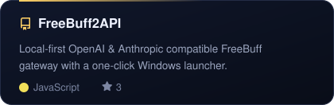</a>
  <a href="https://github.com/wintopic/codex-longwatch">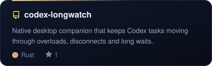</a>
  <a href="https://github.com/wintopic/CodexPanel">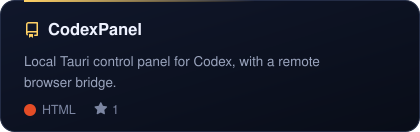</a>
  <a href="https://github.com/wintopic/Codex-Desktop-Linux">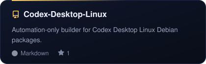</a>

### 🖥️ Native desktop & design systems

  <a href="https://github.com/wintopic/CF-BEST">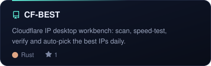</a>
  <a href="https://github.com/wintopic/TDesign-GPUI">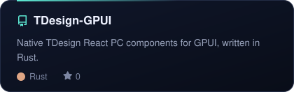</a>
  <a href="https://github.com/wintopic/QoderDesign">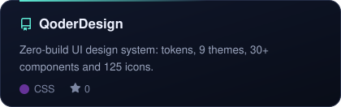</a>
  <a href="https://github.com/wintopic/lightpaper">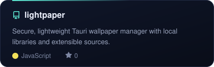</a>

### 📱 Android & Linux utilities

  <a href="https://github.com/wintopic/FullCharge">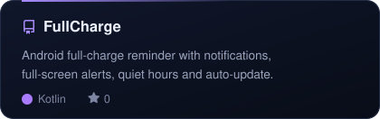</a>
  <a href="https://github.com/wintopic/Teambox">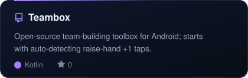</a>
  <a href="https://github.com/wintopic/ClearFrame">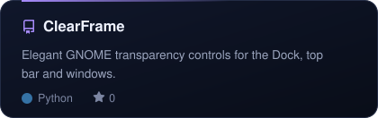</a>
  <a href="https://github.com/wintopic/gnome-topline">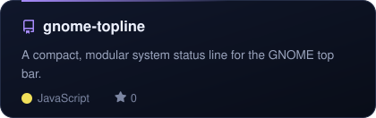</a>

### 🧰 Web & productivity

  <a href="https://github.com/wintopic/DOUYIN_EMOJI">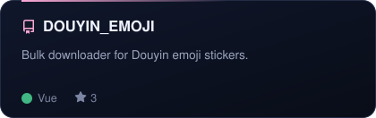</a>
  <a href="https://github.com/wintopic/Feishu_Downloader">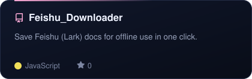</a>
  <a href="https://github.com/wintopic/PixelSign">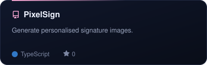</a>
  <a href="https://github.com/wintopic/CozyDo">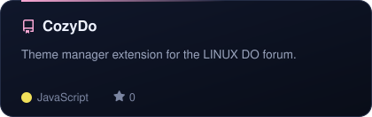</a>

<a href="https://github.com/wintopic?tab=repositories">→ All repositories</a>

### 🛠️ Tech I use

  

### 📊 Overview

  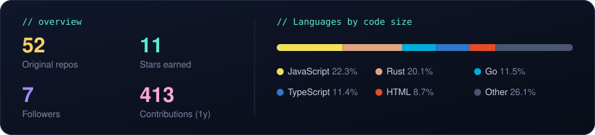

  <picture>
    <source media="(prefers-color-scheme: dark)" srcset="https://raw.githubusercontent.com/wintopic/wintopic/output/snake-dark.svg" />
    
  </picture>

 

Cards and stats are refreshed daily by GitHub Actions

