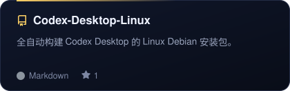
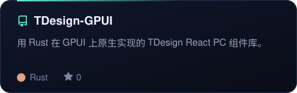
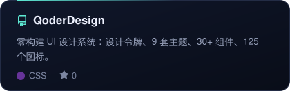
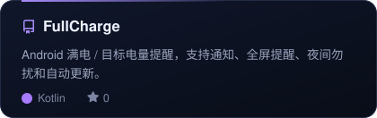
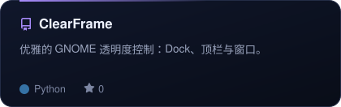
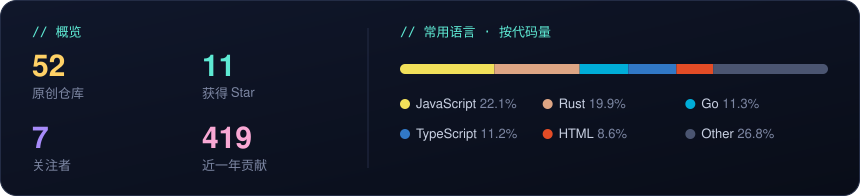

**简体中文** · [English](./README.en.md)

 

我喜欢把日常里反复遇到的麻烦做成小工具：给 AI 智能体修路搭桥，用 Rust 写原生桌面应用，再顺手把 Android 和 Linux 桌面打磨得更顺手。大多数项目都是**本地优先**，开箱即用。

### 🤖 AI 智能体工具链

  
  
  
  

### 🖥️ 原生桌面与设计系统

  
  
  
  

### 📱 Android 与 Linux 小工具

  
  
  
  

### 🧰 Web 与效率工具

  
  
  
  

<a href="https://github.com/wintopic?tab=repositories">→ 查看全部仓库</a>

### 🛠️ 常用技术

  

### 📊 概览

  

  <picture>
    <source media="(prefers-color-scheme: dark)" srcset="https://raw.githubusercontent.com/wintopic/wintopic/output/snake-dark.svg" />
    
  </picture>

 

卡片与统计每天由 GitHub Actions 自动更新

